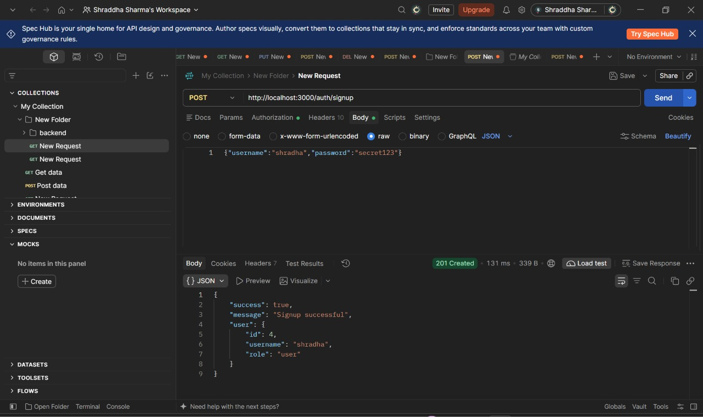
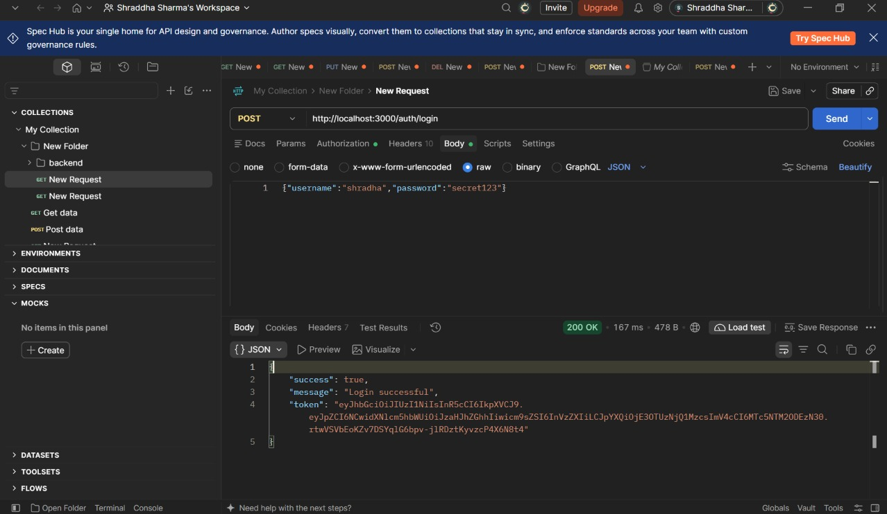
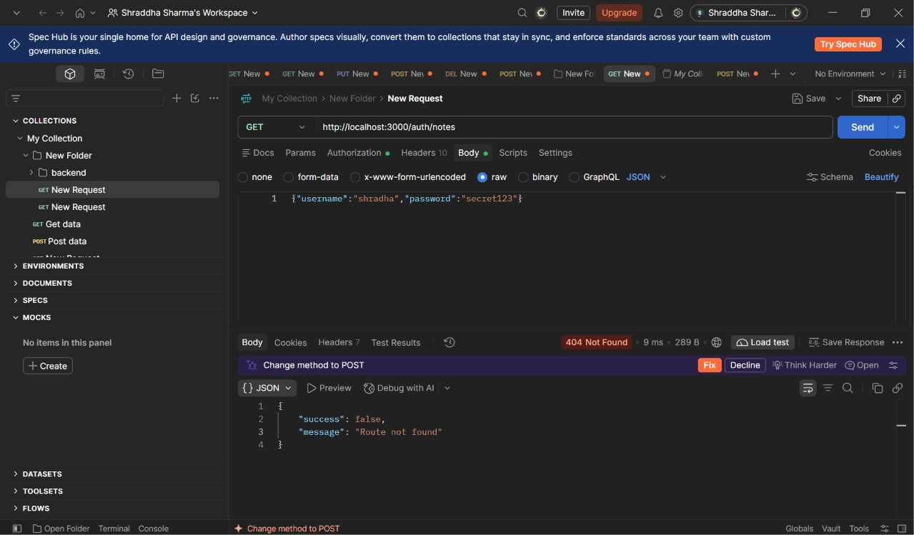
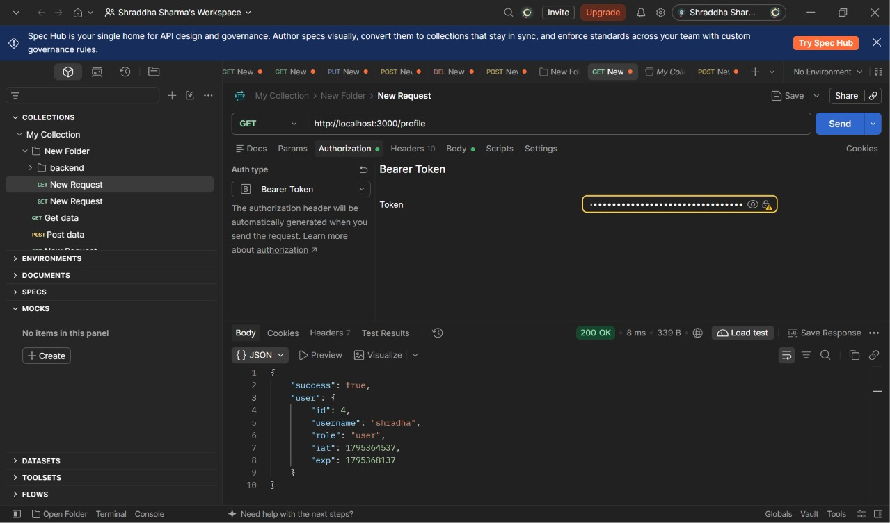

# Lab 4 - Secure Connect and Communication Platform

Backend project (Web Dev III, Unit 4) built with Node.js, Express, JWT, bcrypt, dotenv and Socket.IO.
Data is stored in memory (arrays), so it resets when the server restarts.

## Features
- Signup and login with bcrypt password hashing
- JWT authentication and protected routes
- Role-based access control (user / admin)
- Secure Notes API (CRUD, each user sees only their own notes)
- Real-time chat using Socket.IO (JWT-secured)
- Event-driven logging using EventEmitter

## Setup
```bash
npm install
cp .env.example .env     # then set your own JWT_SECRET
npm start                # http://localhost:3000
```

## API Endpoints
| Method | Route | Access |
|---|---|---|
| POST | /auth/signup | public (username, password, optional role "admin") |
| POST | /auth/login | public, returns JWT |
| GET | /profile | logged-in user |
| GET | /admin/users | admin only |
| POST, GET | /notes | own notes |
| GET, PUT, DELETE | /notes/:id | own notes |

Send the token as: `Authorization: Bearer <token>`

## Postman Output Screenshots

### 1. Signup


### 2. Login (JWT token returned)


### 3. Notes API blocked without token


### 4. Protected route /profile with token


### 5. Admin route as normal user (403)


### 6. Admin route as admin (200)


### 7. Create note


### 8. Get all notes


### 9. Update note


### 10. Delete note


## Real-Time Chat (Socket.IO)

### 11. Chat in browser (two users)


### 12. Server console showing [EVENT] and [SOCKET] logs

